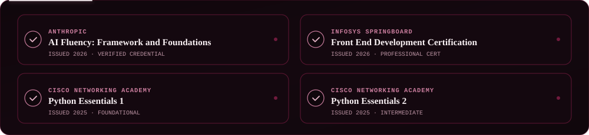
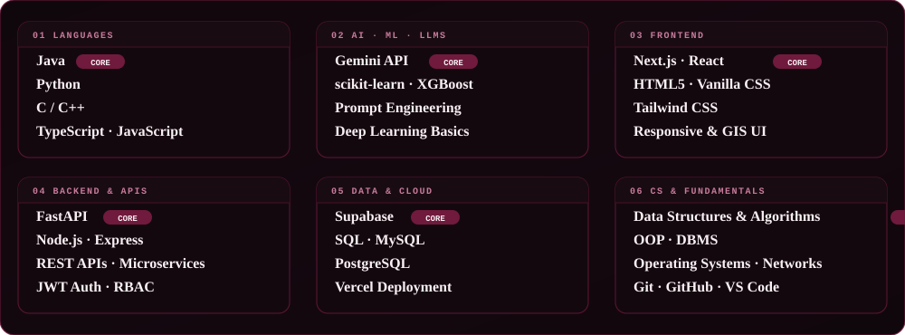
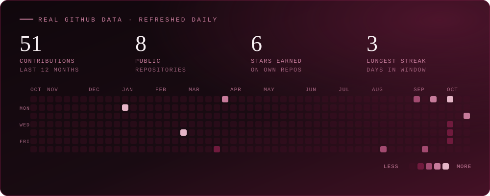

  

  
  

## 

I'm a Computer Science Engineering student at Prasad V Potluri Siddhartha Institute of Technology (B.Tech, 2024–2028) in Andhra Pradesh, India. I'm interested in AI/ML, full-stack development and problem-solving, and I like turning those interests into practical applications. I work with Java, Python, React, Next.js, FastAPI, Supabase and the Gemini API, and I'm looking for Software Development or AI/ML internships.

## 

A full-stack disaster coordination platform with real-time incident dispatching, GIS map visualization, resource allocation and response workflows. Gemini powers incident classification and dynamic flood-route replanning, backed by a fail-safe heuristic rule engine. Supabase Row Level Security and access policies protect the data, and the project includes disaster simulation environments. Deployed on Vercel.

  

Explains source code, detects bugs, analyzes algorithmic complexity and suggests optimizations using Gemini. A React frontend and FastAPI backend present structured feedback to help users understand, debug and improve their solutions.

  

An end-to-end fraud detection system built on a highly imbalanced dataset. It compares Logistic Regression, Random Forest and XGBoost. A FastAPI backend returns risk predictions with plain-language explanations, and an animated web interface shows risk scores, verdicts and explanations.

  

## 

## 

## 

## 

  
  &nbsp;&nbsp;
  

  

